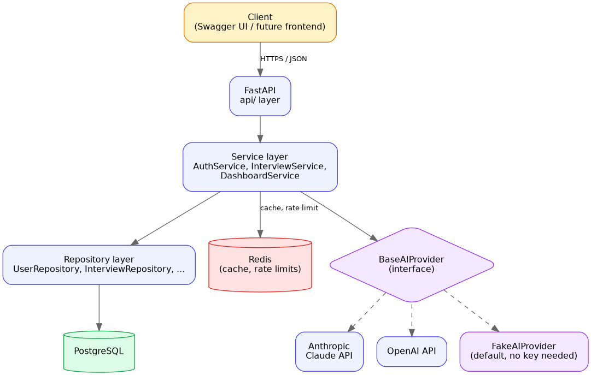
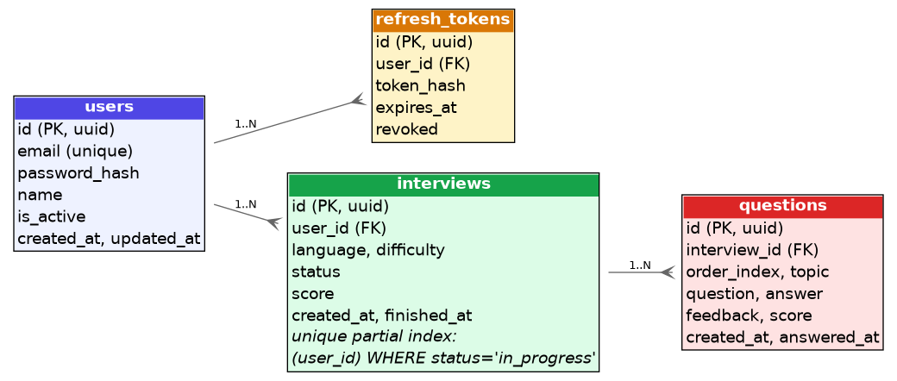

# SkillForge AI

AI-powered mock technical interview platform. Pick a language and a difficulty, get interviewed question by question, receive a scored evaluation and specific feedback on each answer, and track how you're trending over time.

Backend is complete and tested (v1.0.0) — a browser UI is planned as a follow-up phase (see [Roadmap](#roadmap)). Right now the product is fully usable through the interactive API docs at `/docs`.

## Quick look

```
POST /api/v1/interviews          {"language": "python", "difficulty": "middle"}
  -> first question

POST /api/v1/interviews/{id}/answer   {"question_id": "...", "answer": "..."}
  -> score, feedback, next question (or "completed" once the session is done)

GET  /api/v1/dashboard/stats
  -> total interviews, average score, strongest and weakest topics
```

That's the whole product loop. Full request/response shapes are in [docs/api.md](docs/api.md), or just try it live in Swagger at `/docs` (see [Try it](#try-it) below).

## Architecture



FastAPI on top of a layered `api -> service -> repository -> model` structure, so business rules never depend on the web framework or the ORM directly. The AI integration sits behind a `BaseAIProvider` interface (Strategy pattern) — `AnthropicProvider` and `OpenAIProvider` are thin, swappable implementations behind a shared retry/backoff/JSON-parsing base class, and a `FakeAIProvider` means the whole app runs and is fully testable with zero API keys. Full writeup in [docs/architecture.md](docs/architecture.md).

## Tech stack

FastAPI · SQLAlchemy 2.0 (async) · PostgreSQL · Redis · Alembic · JWT auth · Docker Compose · pytest · GitHub Actions

## Try it

```bash
git clone <this-repo>
cd skillforge-ai
cp .env.example .env
docker compose up --build
```

Open `http://localhost:8000/docs` — that's a full interactive Swagger UI, not just documentation. Register a user, log in, click **Authorize** and paste `Bearer <access_token>`, then start an interview and answer questions right from the browser. No API key needed: `AI_PROVIDER` defaults to a deterministic fake provider, so the whole loop works out of the box.

Want a real LLM instead of the fake one? Set `AI_PROVIDER=anthropic` (or `openai`) and the matching `*_API_KEY` in `.env`, then restart.

```bash
# once you have a key, a quick multi-language sanity check:
AI_PROVIDER=anthropic ANTHROPIC_API_KEY=sk-... python scripts/manual_qa.py
```

## Data model



Four tables: `users`, `refresh_tokens`, `interviews`, `questions`. A partial unique index enforces "one active interview per user" at the database level, not just in application code. Full schema in [docs/database.md](docs/database.md).

## Testing

```bash
python -m venv .venv && source .venv/bin/activate
pip install -r requirements-dev.txt
docker compose up -d db redis
pytest --cov=app --cov-report=term-missing
```

62 tests (unit + integration, against a real Postgres/Redis, not mocks-all-the-way-down), 94%+ coverage on `app/services` and `app/api`, enforced as a CI gate. A separate live-provider test exists but is skipped unless `RUN_LIVE_AI_TESTS=1` and a real API key are set, so CI never needs credentials.

There's also a basic concurrency/latency check for the answer-evaluation endpoint:

```bash
python scripts/load_test.py
```

## API

Full spec with every endpoint, request/response schema, and error code: [docs/api.md](docs/api.md). Interactive version at `/docs` once the app is running.

| | |
|---|---|
| Auth | `POST /auth/register`, `/login`, `/refresh`, `/logout` |
| Profile | `GET/PUT /profile/me` |
| Interview | `POST /interviews`, `/interviews/{id}/answer`, `/interviews/{id}/finish`, `GET /interviews/{id}`, `GET /interviews` |
| Dashboard | `GET /dashboard/stats` |

## Docs

- [Vision](docs/vision.md) — what this is and isn't
- [Requirements](docs/requirements.md) — functional + non-functional, with acceptance criteria
- [Architecture](docs/architecture.md) — layering, patterns, tech choices
- [Database design](docs/database.md) — schema, indexes, ER diagram
- [API specification](docs/api.md) — every endpoint
- [Roadmap](docs/roadmap.md) — sprint-by-sprint task breakdown
- [Deployment guide](docs/deployment.md) — running this outside Docker Compose

## Roadmap

- [x] Sprint 1 — Project scaffold (Docker, CI, structured logging, health check)
- [x] Sprint 2 — Auth (JWT access/refresh, bcrypt, rate limiting)
- [x] Sprint 3 — Interview core (state machine, scoring)
- [x] Sprint 4 — Real AI integration (Anthropic/OpenAI providers, caching, retries)
- [x] Sprint 5 — Dashboard, hardening, load testing
- [x] Sprint 6 — Docs, diagrams, v1.0.0 release
- [ ] Frontend — a minimal web UI on top of this API (separate phase, not started)

Full task-level detail: [docs/roadmap.md](docs/roadmap.md).

## License

MIT — see [LICENSE](LICENSE).
