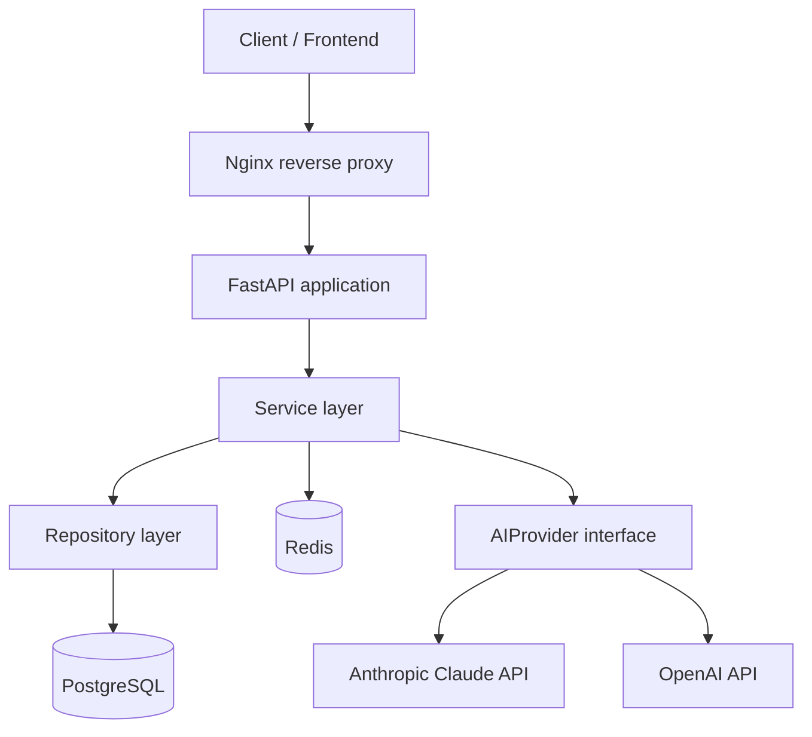

# SkillForge AI — Architecture

## 1. High-Level Diagram



## 2. Layering

The backend follows a strict layered / clean-architecture style so business logic never depends directly on FastAPI or on SQLAlchemy:

- **api/** — HTTP layer only. Parses requests, calls a service, serializes the response. No business logic, no direct DB access.
- **services/** — business logic. Orchestrates repositories and the AI provider, enforces business rules (e.g. "one in-progress interview at a time"). Framework-agnostic — no `Request`/`Response` objects here.
- **repositories/** — data access. One repository per aggregate (`UserRepository`, `InterviewRepository`, `QuestionRepository`). Each exposes methods like `get_by_id`, `create`, `list_by_user`, and hides SQLAlchemy specifics from the service layer.
- **models/** — SQLAlchemy ORM models (the DB schema in code).
- **schemas/** — Pydantic request/response models. Never reuse ORM models as API schemas directly, to avoid leaking DB columns (like `password_hash`) into responses by accident.

This separation means the Repository Pattern does real work: the service layer talks to an interface (`UserRepository`), not to `Session.query(...)` directly, so repositories are swappable and mockable in tests.

## 3. AI Provider Abstraction

The AI integration is the component most likely to change (provider, pricing, model version), so it sits behind an interface rather than being called directly from the service layer:

```python
class BaseAIProvider(ABC):
    async def generate_question(self, language: str, difficulty: str, exclude_topics: list[str]) -> GeneratedQuestion: ...
    async def evaluate_answer(self, question: str, answer: str) -> Evaluation: ...
```

`AnthropicProvider` and `OpenAIProvider` both implement this interface. `InterviewService` depends only on `BaseAIProvider`, injected at startup from config — switching providers is a one-line config change, not a code change. This is also a clean place to demonstrate the Strategy pattern in the codebase.

## 4. Technology Stack

| Layer | Choice | Why |
|---|---|---|
| API framework | FastAPI | Async-first, automatic OpenAPI/Swagger docs, Pydantic validation built in |
| ORM | SQLAlchemy 2.0 (async) | Industry-standard, pairs well with the repository pattern |
| Migrations | Alembic | Standard companion to SQLAlchemy |
| Database | PostgreSQL | Relational integrity for users/interviews/questions |
| Cache | Redis | Dashboard-stat caching, question caching |
| Auth | JWT (access + refresh) | Stateless access tokens, revocable refresh tokens |
| AI | Claude API / OpenAI API behind `BaseAIProvider` | Swappable, testable via a fake provider |
| Testing | pytest, pytest-asyncio, httpx (ASGI test client) | Async-native test stack matching the app |
| CI/CD | GitHub Actions | Lint + test + coverage on every PR |
| Containerization | Docker, docker-compose | `docker compose up` brings up API + Postgres + Redis together |

## 5. Directory Structure

```
skillforge-ai/
├── app/
│   ├── main.py
│   ├── core/            # config, security (JWT), logging, exceptions
│   ├── api/
│   │   └── v1/           # auth.py, profile.py, interview.py, history.py, dashboard.py, router.py
│   ├── schemas/          # Pydantic request/response models
│   ├── models/           # SQLAlchemy models
│   ├── repositories/     # base.py + one repo per aggregate
│   ├── services/         # auth_service.py, interview_service.py, dashboard_service.py
│   ├── ai/               # base_provider.py, anthropic_provider.py, openai_provider.py, prompts.py
│   ├── db/               # session.py, redis.py
│   └── utils/
├── alembic/
├── tests/
│   ├── unit/
│   ├── integration/
│   └── conftest.py
├── docs/                  # this folder
├── .github/workflows/ci.yml
├── docker/Dockerfile
├── docker-compose.yml
├── .env.example
├── pyproject.toml
├── alembic.ini
├── CONTRIBUTING.md
├── LICENSE
└── README.md
```

## 6. Caching Strategy

- Dashboard stats (`GET /dashboard/stats`) are cached per user with a short TTL (e.g. 5 minutes) and explicitly invalidated when an interview is marked `completed`.
- Nothing else is cached in v1 — premature caching of write-heavy or rarely-read data isn't worth the invalidation complexity.

## 7. Async Strategy

Every I/O-bound operation — DB queries, Redis calls, AI provider HTTP calls — is `async`/`await` end to end, using an async SQLAlchemy engine and an async HTTP client (httpx) for the AI provider. This matters specifically for `evaluate_answer`, the slowest call in the system (a network round trip to an LLM); keeping it async means one slow AI call doesn't block other requests on the same worker.
