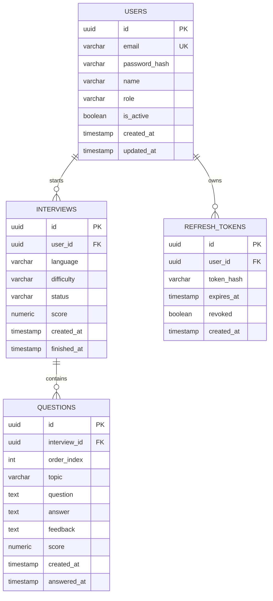

# SkillForge AI — Database Design

## 1. ER Diagram

## 2. Table Definitions

### users
| Column | Type | Constraints |
|---|---|---|
| id | UUID | PK, default `gen_random_uuid()` |
| email | VARCHAR(255) | UNIQUE, NOT NULL |
| password_hash | VARCHAR(255) | NOT NULL |
| name | VARCHAR(100) | NOT NULL |
| role | VARCHAR(20) | NOT NULL, default `'user'` |
| is_active | BOOLEAN | NOT NULL, default `true` |
| created_at | TIMESTAMPTZ | NOT NULL, default `now()` |
| updated_at | TIMESTAMPTZ | NOT NULL, default `now()` |

Index: unique index on `email` (also serves as the login lookup index).

`role` is `user` or `admin` (the `Role` enum in `app/models/user.py`). It is a plain string with no CHECK constraint on purpose: more roles are planned, and adding one should not need a migration. The API validates the value instead.

### refresh_tokens
| Column | Type | Constraints |
|---|---|---|
| id | UUID | PK |
| user_id | UUID | FK → users.id, NOT NULL, ON DELETE CASCADE |
| token_hash | VARCHAR(255) | NOT NULL — store a hash of the token, never the raw token |
| expires_at | TIMESTAMPTZ | NOT NULL |
| revoked | BOOLEAN | NOT NULL, default `false` |
| created_at | TIMESTAMPTZ | NOT NULL, default `now()` |

Index: `user_id`; index on `token_hash` for fast lookup on refresh.

### interviews
| Column | Type | Constraints |
|---|---|---|
| id | UUID | PK |
| user_id | UUID | FK → users.id, NOT NULL, ON DELETE CASCADE |
| language | VARCHAR(20) | NOT NULL, CHECK IN ('python','java','cpp','javascript') |
| difficulty | VARCHAR(10) | NOT NULL, CHECK IN ('junior','middle','senior') |
| status | VARCHAR(20) | NOT NULL, default `'in_progress'`, CHECK IN ('in_progress','completed','abandoned') |
| score | NUMERIC(5,2) | NULLABLE — set when status leaves `in_progress` |
| created_at | TIMESTAMPTZ | NOT NULL, default `now()` |
| finished_at | TIMESTAMPTZ | NULLABLE |

Index: `user_id`; **unique** partial index on `(user_id) WHERE status = 'in_progress'` — enforces "one active interview per user" at the database level, not just in application code, so two concurrent `start()` calls can't both slip through.

### questions
| Column | Type | Constraints |
|---|---|---|
| id | UUID | PK |
| interview_id | UUID | FK → interviews.id, NOT NULL, ON DELETE CASCADE |
| order_index | INT | NOT NULL |
| topic | VARCHAR(50) | NOT NULL — e.g. `"arrays"`, `"concurrency"`, `"sql"`; drives dashboard strong/weak topics |
| question | TEXT | NOT NULL |
| answer | TEXT | NULLABLE — null until the user answers |
| feedback | TEXT | NULLABLE |
| score | NUMERIC(5,2) | NULLABLE |
| created_at | TIMESTAMPTZ | NOT NULL, default `now()` |
| answered_at | TIMESTAMPTZ | NULLABLE |

Index: `interview_id`; composite index on `(interview_id, order_index)` for ordered retrieval.

## 3. Migrations

All schema changes go through Alembic (`alembic revision --autogenerate -m "..."`). No manual schema edits against the running database, including in local dev — this keeps `alembic upgrade head` a reliable way to reproduce the schema from scratch, which CI and `docker compose up` both rely on.

## 4. Notes on Design Choices

- UUID primary keys (not auto-increment ints) so IDs are safe to expose in URLs without leaking row counts.
- `topic` lives directly on `questions`, not in a separate lookup table — v1 doesn't need topic management (rename/merge/etc.), so a plain varchar keeps the schema simpler. A `topics` table is a reasonable v2 addition once topic analytics need more structure.
- Soft-delete is intentionally not used anywhere in v1 — no requirement needs it, and it would complicate every query with a `deleted_at IS NULL` filter.
